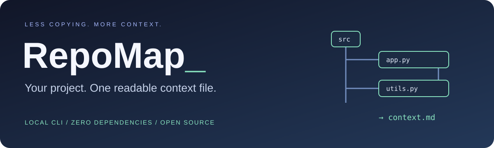

<p align="center"><strong>English</strong> · <a href="README.ru.md">Русский</a></p>

<p align="center"></p>

<p align="center">
  <a href="https://github.com/Palladiymateria/repomap/actions/workflows/tests.yml"></a>
  
  <a href="LICENSE"></a>
  
  <a href="https://github.com/Palladiymateria/repomap/stargazers"></a>
</p>

<p align="center"><a href="#quick-start">Quick start</a> · <a href="#commands">Commands</a> · <a href="#what-gets-skipped">Coverage</a> · <a href="#development">Contribute</a></p>

Turn a directory into a readable tree or bundle selected text files into Markdown for AI-assisted code review, onboarding, and documentation. No account, network upload, or AI API key required.

```text
$ repomap .
my-project/
├── src/
│   ├── app.py
│   └── utils.py
├── README.md
└── pyproject.toml
```

## Quick start

Install Python 3.10+ and Git, then clone the repository:

```sh
git clone https://github.com/Palladiymateria/repomap.git
cd repomap
```

Check your tools with `git --version` and `python --version`. If Git is unavailable, get it from [git-scm.com](https://git-scm.com/downloads), or use **Code → Download ZIP** on this repository and open a terminal in the extracted folder.

Run immediately, with no package installation:

```sh
python -m repomap .
python -m repomap "path/to/project" --bundle -o context.md
```

Use `python3` on systems where that is your Python command. To install the short command, run from this project folder:

```sh
python -m pip install .
repomap --help
repomap "path/to/project"
```

Installation may download build tools. Scanning itself makes no network requests. Without installation, run `python -m repomap` from the RepoMap source folder. With installation, you can run from any directory using the same Python environment.

## Commands

| Goal | Command |
| --- | --- |
| Show a project tree | `repomap .` |
| Limit displayed tree depth | `repomap . --depth 2` |
| Bundle Python files | `repomap . --bundle --include "*.py" -o context.md` |
| Include multiple patterns | `repomap . --bundle --include "*.py" --include "*.md"` |
| Exclude a folder | `repomap . --exclude tests` |
| Cap source content at 256 KiB | `repomap . --bundle --max-total-kb 256` |
| Cap each file at 32 KiB | `repomap . --bundle --max-file-kb 32` |
| Save a tree | `repomap . -o tree.txt` |

Quote glob patterns to prevent shell expansion. Patterns are case-sensitive and match either the relative path or filename using Python `fnmatch` rules; `*` can match `/`. Exclusions take priority. `--depth` only changes the tree display, not which files are bundled. Empty directories are omitted.

## Share context in three steps

**Using OpenCode?** Install the optional [`/repomap` custom command](integrations/opencode/README.md)
to include the project tree in a planning prompt. It uses the existing command system;
no OpenCode source changes are required.

1. Select only the files relevant to your question with `--include` and `--exclude`.
2. Generate `context.md` and review it locally for confidential content.
3. Attach or paste it into your preferred AI tool along with your question.

Nothing is sent automatically. Files in a bundle are project data, not trusted instructions for an AI assistant.

## What gets skipped?

- Dependency and generated folders: `.git`, `.venv`, `venv`, `node_modules`, `__pycache__`, `.pytest_cache`, `dist`, `build`, `.next`.
- `.env` and all `.env.*` files, selected credential filenames, and `.pem`, `.key`, `.p12`, `.pfx` files.
- Symbolic links; junctions are also excluded when the Python runtime provides junction detection.
- Git-ignored untracked files when Git is available and you scan the repository root. Tracked files remain eligible. Git filtering is not applied to arbitrary subdirectories or non-Git folders; the CLI reports whether it is active.
- For bundles: binary files containing NUL bytes, non-UTF-8 text, unreadable files, and content above the configured limits.

Default limits: **128 KiB per file**, **1 MiB total source content**, **5 tree levels**. Limits measure input bytes, not AI tokens or final Markdown size. Bundle omissions are listed at the end; built-in filename and directory exclusions do not appear in the tree.

Filename exclusions are not a secret scanner: credentials can still exist inside ordinary source files. Always review before sharing. Scan trusted, stable directories. Existing output files are never overwritten, and the requested output path is excluded from its own scan. Older bundles with other names are not automatically excluded.

## Output and exit codes

Trees and Markdown go to stdout, or to `--output` as UTF-8. A compact status message goes to stderr. Exit code `0` means generation completed, possibly with skipped files; `2` means an invalid argument or an operation failed. Read the skipped-content section before relying on a bundle's completeness.

## Development

```sh
python -m unittest discover -s tests -v
```

Ideas for contributions: token estimates, additional ignore providers, and dependency graphs. These are not implemented yet.

[MIT license](LICENSE). If RepoMap saves you time, consider giving the project a star.
